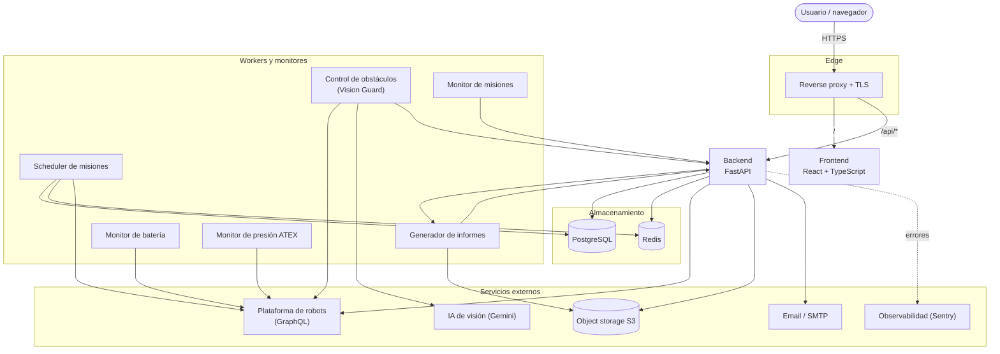

# 🤖 Robot Mission Scheduler & Monitoring Platform

> Plataforma web para **planificar y monitorizar misiones de robots de inspección autónoma** en
> instalaciones industriales del sector **oil & gas**: seguimiento en tiempo real, control de batería,
> KPIs/OEE, informes automáticos con IA y control de obstáculos por visión.

*Caso de estudio de un sistema en producción que diseño y mantengo para clientes industriales.
Este repositorio es una **muestra de capacidades**: el código fuente es privado.*

---

## 🎯 El problema

Los robots de inspección recorren plantas industriales tomando lecturas (manómetros, niveles, gas,
termografía) en puntos de interés. Operar una flota implica: programar misiones, vigilar baterías,
reaccionar a obstáculos, recopilar evidencias y generar informes — hoy, de forma fiable y a varias
plantas a la vez.

## 💡 La solución

Una plataforma multi-servicio que centraliza toda la operación:

- **Planificación de misiones** (puntuales, diarias, semanales) con scheduler tolerante a fallos.
- **Monitorización en tiempo real**: estado de misión, batería, posición en mapa y eventos.
- **KPIs / OEE**: disponibilidad, rendimiento y calidad, con histórico y tendencias.
- **Galerías de imágenes** de POIs y de misión, con visor y descarga por lotes.
- **Informes PDF automáticos** con lectura de manómetros mediante **IA de visión**.
- **Vision Guard**: clasificación de obstáculos con un modelo multimodal (Gemini) y *fallback* automático.
- **Notificaciones** por correo (batería, gas, misión completada, obstáculo persistente) con preferencias por usuario.
- **Multi-planta y multi-robot**, con control de acceso por rol y por sitio.

---

## 🏗️ Arquitectura

> Diagrama simplificado. Solo el reverse proxy se expone a Internet; el resto de servicios viven en
> una red interna. Los servicios internos se autentican entre sí con un token compartido.

---

## 🧰 Stack tecnológico

| Capa | Tecnologías |
|---|---|
| **Backend** | Python · FastAPI · SQLAlchemy (async) · Alembic · Redis · GraphQL · Pydantic |
| **Frontend** | React 18 · TypeScript · Vite · TailwindCSS · TanStack Query · Leaflet · Recharts |
| **IA** | Gemini (visión multimodal) para lectura de instrumentos y clasificación de obstáculos |
| **Infra** | Docker Compose · Caddy · PostgreSQL · Redis · GitHub Actions (CI/CD) |
| **Cloud** | AWS S3 (almacenamiento de informes y backups) |
| **Observabilidad** | Sentry (backend + frontend) |

---

## ⚙️ Aspectos de ingeniería destacados

Más allá de las features, este es el tipo de trabajo que aporto:

- **🔒 Seguridad**: control de acceso por rol y por sitio (prevención de IDOR), protección SSRF,
  autenticación servicio-a-servicio, cabeceras de seguridad (HSTS/CSP), gestión de secretos y
  validación de configuración que impide arrancar con secretos débiles en producción.
- **🔭 Observabilidad**: error tracking end-to-end (servidor y navegador), con túnel propio para que
  los bloqueadores de anuncios no descarten los errores de cliente.
- **⚡ Rendimiento (frontend)**: *code-splitting* por ruta y *chunking* de librerías pesadas (carga
  inicial ~3-5× más ligera); estados de carga tipo *skeleton*; polling inteligente que se pausa
  cuando la pestaña está en segundo plano para no saturar APIs externas.
- **🛡️ Robustez**: *error boundaries* y auto-recuperación ante despliegues (sin pantallas en blanco);
  reintentos con refresco de token ante fallos de autenticación de APIs externas; *fallback* de
  modelo de IA ante timeouts.
- **🤝 Fiabilidad operativa**: scheduler con *leader election* (lock por lease en Redis), backups
  automáticos a S3, guard de disco y limpieza programada.
- **🚀 CI/CD**: pipeline de build/lint/typecheck en cada cambio y despliegue automatizado por planta.

---

## 👤 Mi rol

Diseño, desarrollo y mantenimiento de la plataforma de extremo a extremo: arquitectura, backend,
frontend, integración con la plataforma de robots y los servicios de IA, infraestructura de
despliegue, seguridad y observabilidad.

---

## 📬 Contacto

**Ander Sein** — Ingeniero de automatización e IIoT
🌐 [andersein.com](https://andersein.com) · 📧 [aseinotegi@gmail.com](mailto:aseinotegi@gmail.com) · 💼 [LinkedIn](https://www.linkedin.com/in/ander-sein-a24097195/)

*¿Tienes un reto de software industrial, robótica o plataformas de datos? Hablemos.*
